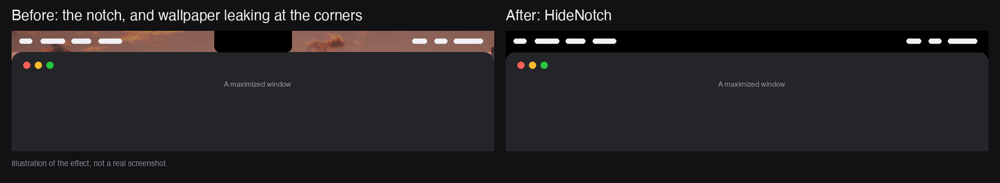
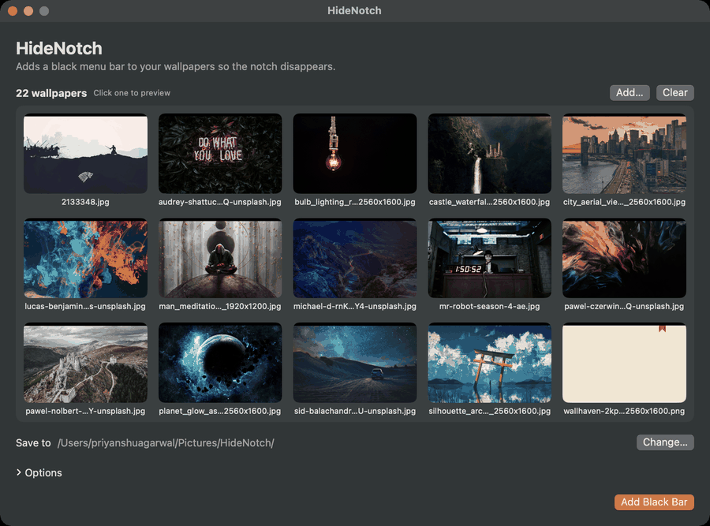
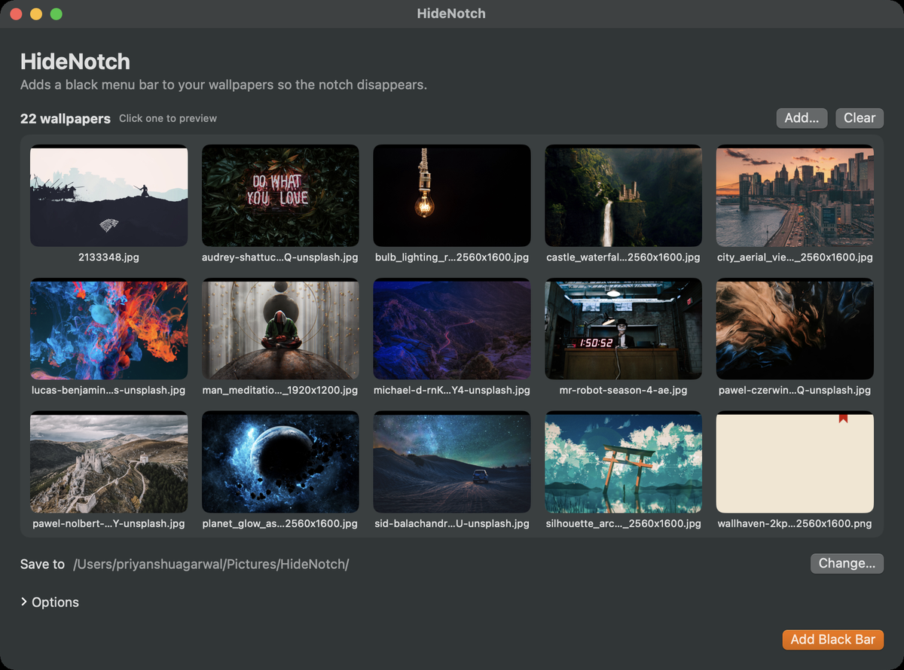

<p align="center">
  
</p>

<h1 align="center">HideNotch</h1>

**HideNotch hides the MacBook notch** by adding a black menu bar to your wallpapers. It is a free, open-source
**TopNotch alternative** for MacBook Pro and MacBook Air: instead of drawing an overlay on screen, the black bar is baked
into the wallpaper image itself, so there is nothing for a macOS update to break.



It also closes the **wallpaper leak at window corners**: the sliver of wallpaper that can show between a window's rounded
top corners and the black menu bar. HideNotch paints small black corner fillers into the wallpaper exactly where macOS
draws those rounded corners, so nothing bleeds through.



## Install

### Homebrew

```bash
brew install --cask agpriyanshu/tap/hidenotch
```

### Manual

1. Download `HideNotch-<version>.dmg` from the [latest release](../../releases/latest).
2. Open it and drag **HideNotch** to **Applications**.
3. The app is ad-hoc signed, not notarized. On first launch right-click the app, choose **Open**, then **Open** again.
   If macOS still refuses, run `xattr -dr com.apple.quarantine /Applications/HideNotch.app`.

## Use

1. Drop your wallpapers (or a folder of them) onto the window or the Dock icon. They show up as a thumbnail gallery.
   Click any thumbnail to preview it with the black bar applied.
2. Click **Add Black Bar**. New copies are written to `~/Pictures/HideNotch` by default; your originals are untouched.
3. Select a result in the list and click **Set as Wallpaper**. It is applied to your notched display with **Fill Screen**
   placement. You can also pick the new images yourself in **System Settings → Wallpaper**.



## Menu bar mode

HideNotch also lives in the menu bar. Turn on **Hide Notch** from its menu and it takes your *current* wallpaper,
generates a copy with the black bar and corner fillers, and sets that as the wallpaper on **every connected display**.
Each display gets its own copy, sized to its resolution, and external monitors get a black bar as tall as their menu bar.
Turn it off to get your original wallpapers back. If you pick a new wallpaper later, choose **Apply to Current Wallpaper Again**.

The menu bar mode uses the same bar height and corner radius as the window (see **Options**). It needs a single image as
the wallpaper; a folder of images or a dynamic wallpaper is not supported there.

## How it works

- **Bar height** is measured from your display's notch geometry, relative to its default resolution, so it stays correct
  when you switch to a scaled ("More Space") mode.
- **Crop-aware.** macOS fills the screen and crops the overflow evenly, so the bar is placed below any rows macOS crops
  from taller images.
- **No wallpaper leak at the corners.** Small black fillers sit under the bar at the visible left and right edges, where
  the rounded top corners of maximized windows would otherwise let wallpaper peek through between the window and the
  menu bar. They are placed from the crop macOS actually applies, so they line up on every wallpaper size. Tune the
  radius under **Options** if you still see a sliver.

## Build from source

Requires the Xcode command line tools (no full Xcode needed).

```bash
swift build -c release          # just the binary
scripts/build.sh 1.0.0          # HideNotch.app and HideNotch-1.0.0.dmg in ./build
```

`scripts/make_icon.py` regenerates `Resources/AppIcon.icns` (needs Pillow).

## License

MIT
